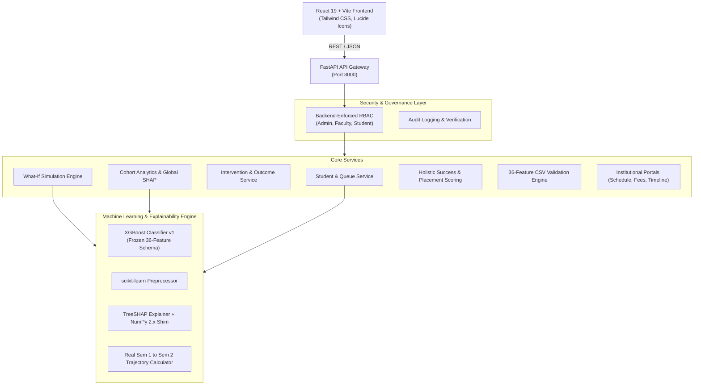

# Student360 — Integrated Smart Campus Analytics & Early Intervention Platform

**KPMG Smart Campus Analytics Challenge**  
*Integrated, Stabilized, and Verified Deliverable*

---

## 1. Project Overview

**Student360** is an enterprise-grade higher-education analytics and student retention platform. It integrates machine learning risk prediction with explainable AI (SHAP), dynamic What-If simulation, human-in-the-loop intervention governance, multi-dimensional success scoring, and comprehensive institutional campus management portals.

This unified build reconciles and solidifies all project requirements into a single, cohesive, production-ready codebase (`Student360_Final_Integrated`).

---

## 2. System Architecture



---

## 3. Core Features & Verified Capabilities

1. **Role-Based Portals (RBAC):**
   - **Administrator Portal:** System configuration, audit logs, fee summaries, user provisioning, CSV batch ingestion.
   - **Faculty / Advisor Portal:** Assigned advisee priority queues, milestone verification, intervention drafting & approval.
   - **Student Portal:** Personal risk trajectory, self-reported achievements/timeline, class timetable, fee records.
2. **Priority Queue & Student 360 Profile:**
   - Real-time risk sorting (High $\ge 70$, Medium $30-69$, Low $< 30$).
   - Comprehensive student view displaying demographic attributes, academic standing, holistic success score, and placement readiness tier.
3. **Local & Global Explainability (TreeSHAP):**
   - Per-student local risk factor attribution identifying top risk and protective drivers.
   - Cohort-wide aggregate risk distribution and mean absolute SHAP feature importance.
4. **Real Academic Progression Trajectory:**
   - Evaluates actual Semester 1 to Semester 2 delta based on approved curricular units and grades.
   - Categorizes trajectory as `improving`, `declining`, or `stable`. Never invents synthetic weekly data.
5. **Counterfactual What-If Simulation:**
   - Live sensitivity modeling against the frozen 36 UCI features schema.
   - Evaluates modified student inputs without retraining or claiming false causal guarantees.
6. **Human-in-the-Loop Intervention & Outcome Demonstration:**
   - AI drafts intervention strategies that require human faculty review and approval.
   - Simulated post-intervention outcome projections prominently marked with `SIMULATED DEMONSTRATION OUTCOME` badge.
7. **Holistic Success Score & Placement Readiness:**
   - **Success Score (5 Pillars):** Academic performance, attendance, LMS engagement, campus activities, placement readiness.
   - **Placement Readiness (4 Competencies):** Aptitude, coding assessments, mock interviews, technical skills.
   - Dynamic weight renormalization for partial data.
8. **Student Education & Career Timeline:**
   - Chronological milestone tracker with self-reporting and faculty verification workflow.
9. **Validated 36-Feature CSV Import:**
   - Pre-ingestion validation checking column headers, data types, value boundaries, and duplicate IDs before database commit.

---

## 4. Quick Start (Windows PowerShell)

### Prerequisites
- **Python 3.10+** (verified on Python 3.14 with NumPy 2.x compatibility shim)
- **Node.js 18+** and **npm**

### Step 1: Clone / Navigate to Directory
```powershell
cd Student360_Final_Integrated
```

### Step 2: Environment Setup
```powershell
# Copy example configuration templates
Copy-Item .env.example .env
Copy-Item backend\.env.example backend\.env
Copy-Item frontend\.env.example frontend\.env
```

### Step 3: Install Backend Dependencies
```powershell
pip install -r backend/requirements.txt
```

### Step 4: Install Frontend Dependencies & Verify Build
```powershell
cd frontend
npm install
npm run build
cd ..
```

---

## 5. Running the Application

### Option A: Using Helper PowerShell Scripts

**Terminal 1 (Backend Server):**
```powershell
.\scripts\start_backend.ps1
```
The FastAPI backend starts at: **http://127.0.0.1:8000** (Swagger docs: `http://127.0.0.1:8000/docs`).

**Terminal 2 (Frontend Dev Server):**
```powershell
.\scripts\start_frontend.ps1
```
The React frontend starts at: **http://localhost:5173**.

---

## 6. Demo Accounts & Credentials

| Role | Username / ID | Password | Portal Access |
| :--- | :--- | :--- | :--- |
| **Administrator** | `ADM001` | `admin123` | Institutional Admin, Priority Queue, Ingestion, Audits |
| **Faculty Advisor** | `FAC001` | `faculty123` | Advisor Queue, Interventions, Milestone Verification |
| **Student** | `S1001` | `student123` | Student 360 Profile, Timetable, Timeline, Fees |

---

## 7. Automated Test Suite & Verification

The unified test suite combines all test cases from both builds and adds comprehensive end-to-end workflow validation.

### Run All Tests via Helper Script
```powershell
.\scripts\run_all_tests.ps1
```

### Run Tests via Pytest Directly
```powershell
pytest -v
```

### Verified Test Results
```
============================ 114 passed in 24.25s =============================
- backend/tests/test_auth_rbac.py: 13 passed
- backend/tests/test_cohort.py: 2 passed
- backend/tests/test_college.py: 18 passed
- backend/tests/test_csv_import.py: 6 passed
- backend/tests/test_e2e_workflow.py: 1 passed (Complete 10-step flow)
- backend/tests/test_end_to_end_integration.py: 1 passed
- backend/tests/test_frontend_integration.py: 2 passed
- backend/tests/test_health.py: 1 passed
- backend/tests/test_intervention.py: 4 passed
- backend/tests/test_model_integration.py: 3 passed
- backend/tests/test_scoring_api.py: 8 passed
- backend/tests/test_simulation.py: 4 passed
- backend/tests/test_students.py: 4 passed
- tests/test_demo_students.py: 2 passed
- tests/test_model.py: 5 passed
- tests/test_prediction.py: 7 passed
- tests/test_preprocessing.py: 5 passed
- ml/scoring/test_scoring.py: 11 passed
- ml/explainability/test_explainability.py: 7 passed
- ml/trajectory/test_trajectory.py: 7 passed
Total: 114 passed, 0 failed, 0 skipped
```

---

## 8. Directory Structure

```
Student360_Final_Integrated/
├── backend/                    # FastAPI Application
│   ├── app/
│   │   ├── routes/             # RBAC Protected API Endpoints
│   │   │   ├── auth.py         # Authentication & Session Management
│   │   │   ├── cohort.py       # Aggregate Risk & Global SHAP
│   │   │   ├── college.py      # Campus Portals (Schedule, Fees, Timeline)
│   │   │   ├── data_import.py  # 36-Feature CSV Validation & Import
│   │   │   ├── intervention.py # Intervention Review & Demonstration Outcomes
│   │   │   ├── scoring.py      # Success Score & Placement Readiness
│   │   │   ├── simulation.py   # Counterfactual What-If Engine
│   │   │   └── students.py     # Priority Queue & Student 360 Profiles
│   │   ├── services/           # Business Logic & Singletons
│   │   ├── schemas.py          # Unified Pydantic Models
│   │   ├── security.py         # Token Validation & RBAC Dependencies
│   │   └── main.py             # FastAPI App Entrypoint & Lifespan
│   ├── data/                   # Initial Seed Records & JSON Storage
│   ├── requirements.txt        # Backend Python Dependencies
│   └── tests/                  # 14 Backend Test Suites (67 Tests)
├── frontend/                   # React 19 + Vite Frontend
│   ├── src/
│   │   ├── components/         # Modular UI Components & Badges
│   │   ├── pages/              # Portal Views (Student360, Portals, Import)
│   │   ├── services/api.js     # Unified API Client
│   │   └── App.jsx             # Main Router & Authentication State
│   ├── dist/                   # Production Static Build Artifacts
│   └── package.json            # Frontend Dependencies & Scripts
├── ml/                         # Machine Learning Pipeline
│   ├── explainability/         # TreeSHAP Explainer & UCI Schema
│   ├── models/                 # Frozen XGBoost Model & Preprocessor
│   ├── prediction/             # Deterministic Predict Routines
│   ├── scoring/                # Holistic & Placement Scoring Logic
│   └── trajectory/             # Sem 1 to Sem 2 Trajectory Calculator
├── docs/                       # Project Documentation & Audit Reports
│   ├── API_CONTRACTS.md        # Complete OpenAPI & JSON Schema Reference
│   ├── FEATURE_COMPARISON.md   # Build_1 vs Build_2 Side-by-Side Analysis
│   ├── INTEGRATION_AUDIT.md    # Master Architecture Audit
│   ├── INTEGRATION_PLAN.md     # 6-Stage Execution Blueprint
│   ├── KNOWN_GAPS.md           # Resolved Integration Gaps
│   ├── MODEL_BASELINE.md       # Model Weights & Determinism Baseline
│   └── MODEL_METHODOLOGY.md    # Machine Learning & Scoring Methodology
├── scripts/                    # Windows PowerShell Helper Scripts
│   ├── start_backend.ps1       # Launch FastAPI Backend
│   ├── start_frontend.ps1      # Launch React/Vite Frontend
│   └── run_all_tests.ps1       # Execute 114 Unified Tests
├── pytest.ini                  # Pytest Configuration
├── .env.example                # Root Environment Template
└── README.md                   # This Master Documentation File
```

---

## 9. Regulatory & Ethical Disclaimers

1. **Human-in-the-Loop Governance:** Machine learning predictions serve as assistive decision-support tools for educators and counselors. The platform enforces human authorization for any retention intervention.
2. **Scientific Interpretation:** Simulated outcomes and counterfactual projections reflect statistical model sensitivity to altered features and do not constitute guaranteed causal outcomes. All demonstration projections are marked with explicit demonstration notices.
